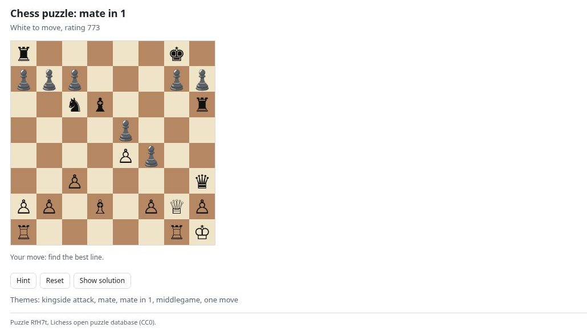

# Chess Puzzles

Train a tactic until you can spot it across the board. Pick forks, pins, mating patterns or endgames at a puzzle rating that suits you. The coach gives you time to find the move, checks it against the puzzle line, then plays the reply.

[Connect with Claude, ChatGPT, Muse Code, or Grok](PROVIDERS.md)

> “Give me a mate in two around 1500. Wait for my move before giving me a hint.”

> “Let's play today's puzzle, then explain the threat I missed.”

## Use it in Claude Code

```sh
claude plugin marketplace add OpZero-sh/plugins
claude plugin install chess-puzzles@opzero
```

A supported client can present a playable board. In a text session, Claude shows the position as a text board with its FEN and accepts moves as coordinates such as `g1f3` or in standard notation such as `Nf3`. Keep a puzzle ID to reopen it later.

## What is included

### Skills

| Skill | Use it for |
| --- | --- |
| `/chess-puzzles:tactics-practice` | A drill on a chosen theme and rating range. Claude serves one position at a time, checks each move you type against the stored line, plays the reply and gives hints in stages only when you ask. |
| `/chess-puzzles:daily-puzzle` | The puzzle of the day. Everyone who asks during the same UTC day gets the same position, so it works for comparing with a friend. |
| `/chess-puzzles:review-a-puzzle` | Reopening a puzzle by its ID to retry it, or a move by move walk through of the solution with the tactical idea named. |

The skills share reference notes in `skills/tactics-practice/references/`: how to read a puzzle result, FEN and move notation, the seventeen theme filters and the labels seen in results, the hint ladder, and notes on the data source and ratings.

### Agent

**tactics-coach** handles one stage of one puzzle: setting up a position, checking a move, giving a single hint or explaining a finished puzzle. It can call only the three read only puzzle tools and it reports what it held back, so the solution is not leaked by accident.

### Hooks

None. Every tool in this plugin is read only, so there is nothing to guard.

## Data source and limits

The public [Chess Puzzles service](https://chess-puzzles.mcp.opzero.sh/) hosts puzzles from the [Lichess open puzzle database](https://database.lichess.org/#puzzles), released under CC0. OpZero publishes this plugin and runs the service. Neither is affiliated with, sponsored by or endorsed by Lichess.

- Ratings are Lichess puzzle ratings. They are their own scale and do not convert to a FIDE or other playing strength.
- The hosted library is a growing part of the full database. A theme and rating combination, or a puzzle ID you found on lichess.org, may not be available yet.
- The daily selection is the service's own pick and changes at 00:00 UTC.
- There is no engine. Moves are checked against the stored puzzle line, and explanations are Claude's reading of that line.
- No account is required and nothing is saved between conversations.

## What the plugin runs, sends and fetches

- **One remote MCP server:** `https://chess-puzzles.mcp.opzero.sh/mcp`. A request carries only the tool arguments: a theme, rating bounds or a puzzle ID. No sign in is used. The service states that requests are not stored.
- **No hooks, no local server and no install step.** Nothing in the plugin runs a program on your machine.
- **No scripts in this repository.** Two optional scripts for people working from a checkout live in the catalog repository, https://github.com/OpZero-sh/plugins. Claude does not run them and the plugin does not need them. They do something only if you clone the catalog and run them yourself.
  - `tools/build_openai.py` in the catalog builds the ZIP package for ChatGPT and Codex from the files in this repository. It reads local files, writes ZIP files to the folder you name and makes no network request.
  - `tools/grok_example.py` in the catalog prepares a request to the xAI API that points Grok at the same MCP server, using the list in `integrations/grok-servers.json`. With `--dry-run` it prints the request and contacts nothing. Without it, the script reads `XAI_API_KEY` and the optional `XAI_MODEL` from your environment and sends your question to `https://api.x.ai/v1/responses`.

## In use

An example from the connected service in Claude.


